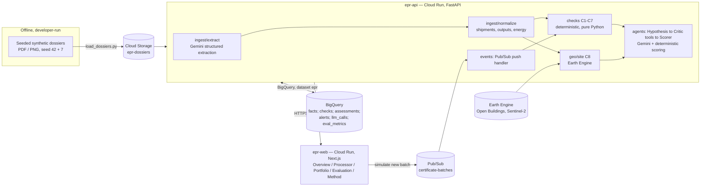

[](https://github.com/raahgir33/epr-integrity-verifier/actions/workflows/ci.yml)

# EPR Integrity Verifier

India's plastic packaging EPR (Extended Producer Responsibility) scheme requires
brands (PIBOs) to buy certificates from Plastic Waste Processors (PWPs) proving
that plastic was recycled. A certificate's paper trail is easy to produce and
hard to independently check — not every certified tonne is backed by real,
traceable material. This system takes a processor's own underlying documents
(invoices, e-way bills, weighbridge slips, consent permits, electricity bills),
reconstructs the material flow they imply, tests that flow against physical
and documentary constraints, and reports how many certified tonnes are
verifiable — with evidence for every finding. It does not accuse anyone of
fraud: findings are reported as *unverifiable*, *inconsistent* or
*implausible*, and the headline number is an environmental one — tonnes of
recycling claims that cannot currently be verified.

Built for the Google Cloud AI Builder Cup 2026 (Sustainability & Social Impact).

**Live demo:** https://epr-web-igr6jyk3na-el.a.run.app

All data in this repository and in the live demo is **synthetic** and clearly
watermarked. Every entity, GSTIN, site and document is fictional; GSTINs are
generated with a deliberately invalid checksum so they cannot match a real
taxpayer. No real company, recycler or brand is named or implied anywhere in
this codebase, data or UI.

## Architecture



Full detail: [`docs/ARCHITECTURE.md`](docs/ARCHITECTURE.md), [`docs/DATA_SPEC.md`](docs/DATA_SPEC.md).

## How Gemini is used

Gemini (`gemini-3.5-flash` on Vertex AI, `asia-south1`) does every task that
needs language understanding; arithmetic that matters to a user is never
delegated to it — every quantity, tonnage, distance and score shown anywhere
in the app is computed by deterministic, unit-tested Python
(`api/app/checks/`, `api/app/agents/scorer.py`).

1. **Semantic translation / extraction** (`ingest/extract.py`) — invoices,
   e-way bills, weighbridge slips, consent permits and electricity bills, in
   mixed formats and some Hindi, become structured facts with per-field
   confidence and source page. Values are captured exactly as printed
   (`"1,23,450 kg"`, `"07/08/2025 14:32"`); all unit conversion and date
   parsing happens afterwards, in code (`ingest/units.py`).
2. **Iterative reasoning and self-correction** (`agents/orchestrator.py`) —
   for each certificate batch, a **Hypothesis** agent argues it is or isn't
   supported, citing evidence; a **Critic** agent (function-calling over
   `run_check`, `get_document_facts`, `get_shipments`, `get_site_assessment`,
   `read_document`) attacks that argument; Hypothesis revises once; a
   deterministic **Scorer** converts the confirmed findings into verifiable /
   unverifiable tonnes and a risk band. Hard rules (evidence-ID required,
   failed hard checks cannot be overruled, one revision max) are enforced in
   code, not left to the prompt.
3. **High-context ingestion** — a processor's dossier is dozens of documents
   across a financial year; the Critic reasons across a compact context pack
   (profile, monthly flow table, every check result with evidence IDs, a
   dossier digest) rather than re-reading every file per call.
4. **Generated memos, English and Hindi** (`agents/memo.py`) — a neutral
   clarification request to a flagged processor, or a verification statement
   for a clean one. Every number and evidence ID in the generated text is
   code-supplied and code-checked against an allow-list before it ships;
   Gemini only writes the connective prose, under an evidence-ID guard, a
   number guard, and a forbidden-word guard (no "fraud"/"fake"/"illegal" in
   either language).
5. **Measured accuracy** — a seeded, held-out synthetic test set (seed 7,
   never used during development) with known planted issues; extraction
   accuracy, detection precision/recall and detection-stability metrics are
   computed in `api/app/eval/evaluate.py` and served at `/evaluation`.

## Evaluation

`/evaluation` reports metrics computed by `api/app/eval/evaluate.py` against
two labelled datasets stored in BigQuery's `eval_metrics` table:

- **`heldout-seed7`** — the headline numbers. A seeded test set never used to
  tune rule thresholds or prompts.
- **`dev-seed42`** — shown secondary, explicitly labelled "rules tuned on it".
  Not evidence of real-world accuracy; included for transparency only.

Metrics include key-field extraction accuracy, per-issue-type recall (rule
checks and agent-only findings), finding precision, false-flag rate on clean
and hard-negative processors, risk-band and unverifiable-tonnes accuracy
against ground truth, run-to-run finding-set agreement and outcome stability
across independent agent runs, and whether a pattern a rule check missed at
least surfaced as a review flag. See [`docs/DATA_SPEC.md`](docs/DATA_SPEC.md) §5
for the planted-issue catalog and [`docs/ARCHITECTURE.md`](docs/ARCHITECTURE.md)
for the full protocol.

## Running locally

### API

```bash
cd api
uv sync
uv run uvicorn app.main:app --reload --port 8080
```

`GET http://localhost:8080/health` returns status, model and region.

### Web

```bash
cd web
npm install
API_BASE_URL=http://localhost:8080 npm run dev
```

Open `http://localhost:3000` — the home page shows the API's health.

### Tests and lint

```bash
cd api && uv run pytest -q && uv run ruff check . && uv run ruff format --check .
cd web && npm run lint && npx tsc --noEmit && npm run test && npm run build
```

## Deployment

Both services deploy to Cloud Run from source; deploy scripts are
developer-run, never automated:

```bash
api/scripts/deploy/deploy_api.sh   # deploys epr-api live immediately
api/scripts/deploy/deploy_web.sh   # deploys epr-web with NO traffic (tagged preview)
# check the printed preview URL, then:
gcloud run services update-traffic epr-web --region=asia-south1 --to-latest
```

First-time setup (BigQuery dataset/tables, Cloud Storage buckets, service
accounts and IAM, Pub/Sub topic, Earth Engine registration) is documented in
[`docs/GCP_SETUP.md`](docs/GCP_SETUP.md).

## Repository layout

```
api/            Python 3.12, FastAPI, Cloud Run service "epr-api"
  app/          ingest, checks, geo, agents, store, events, eval
  scripts/      developer-run: data generation, pipeline, deploy, evaluation
  tests/        pytest; checks and eval metrics are fully unit-tested
web/            Next.js (App Router, TypeScript), Cloud Run service "epr-web"
data/synthetic/ Generated dossiers and ground truth (reproducible from a seed)
assets/fonts/   Fonts used to render Hindi documents (OFL, see THIRD_PARTY_NOTICES.md)
docs/           Architecture, data spec, GCP setup notes
```

## Synthetic data

Every generated document carries a visible `SYNTHETIC — DEMO DATA` watermark.
All processors, suppliers, brands and sites are fictional; GSTINs fail their
checksum deliberately. Real-world map coordinates are used for site
plausibility realism only — coordinates are never shown beyond 2 decimal
places and no street address is shown, so no real business is implied.
Reproduce the data with `uv run python scripts/generate_dossiers.py --seed 42`
(development) or `--seed 7` (held-out test set).

## License

[MIT](LICENSE). Third-party components and assets are listed in
[`THIRD_PARTY_NOTICES.md`](THIRD_PARTY_NOTICES.md).
